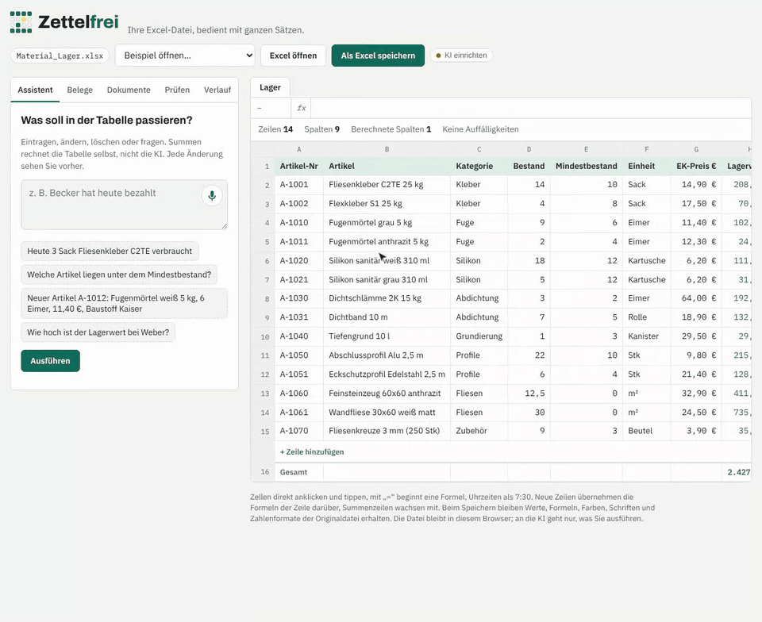

<p align="center">
  <a href="https://uzerwod-boop.github.io/zettelfrei/">
    <picture>
      <source media="(prefers-color-scheme: dark)" srcset="docs/brand/zettelfrei-logo-dark.svg">
      
    </picture>
  </a>
</p>

<h3 align="center">Keep your Excel. Skip the typing.</h3>

<p align="center">
  Small trade businesses run on spreadsheets – timesheets, stock lists, job lists.<br>
  Zettelfrei lets them work with those files in plain sentences and takes care of German paperwork.
</p>

<p align="center">
  <a href="https://uzerwod-boop.github.io/zettelfrei/"><b>Try it online</b></a> ·
  <a href="#what-it-does">What it does</a> ·
  <a href="#quick-start">Quick start</a> ·
  <a href="#ai-setup">AI setup</a> ·
  <a href="README.md">Deutsch</a>
</p>

<p align="center">
  
  <br><sub>Drop in a supplier e-invoice (ZUGFeRD) – read exactly, no AI. Click “Übernehmen” and stock goes up.</sub>
</p>

> [!NOTE]
> The user interface is in German, because the product is built for German businesses. Prototype by **Bohdan Sychevskyi**, built together with a good friend: **Claude** by Anthropic.

## Why

German *Handwerk* businesses (tilers, electricians, plumbers …) keep their operations in Excel files nobody wants to touch. On top of that, the paperwork keeps growing: receiving e-invoices has been mandatory since January 2025, issuing them becomes mandatory step by step from 2027. Zettelfrei keeps the files they already have and removes the typing.

## What it does

- ✍️ **Plain sentences:** “Mehmet heute 7 Stunden Bad Schneider” becomes a new row; “Becker hat heute bezahlt” updates status and date.
- 🧮 **Exact answers:** “How many hours did Kevin work in October?” – the spreadsheet computes the total, not the model. No made-up numbers.
- 👀 **Preview first:** every change is shown as *old → new* and applied only after a click.
- 📥 **E-invoices in:** XRechnung (UBL) and ZUGFeRD/Factur-X (CII) are parsed exactly, without AI. Stock levels and invoice lists update automatically.
- 📤 **E-invoices out:** generates XRechnung 3.0, validated against the official EN 16931 and XRechnung Schematron rules.
- ⏱️ **Working time:** flags violations of the German Working Hours Act (over 10 h/day, missing breaks, under 11 h rest).
- 💶 **Paperwork:** payment reminders as PDF letters, signed acceptance reports on the phone, CSV export for the tax advisor, weekly report.
- 💾 **Your file stays yours:** saved back to `.xlsx` with formulas, colours, fonts and number formats intact. Files are processed in the browser, not uploaded.

Most of it works **without any AI**. AI is only needed for free-form sentences, scanned PDFs and photos.

## Quick start

Requires [Node.js](https://nodejs.org) 18+. No other dependencies.

```bash
git clone https://github.com/uzerwod-boop/zettelfrei.git
cd zettelfrei
npm start        # open http://localhost:8787
```

Five sample spreadsheets and two sample e-invoices are built in.

## AI setup

AI is optional and pluggable – pick one in the settings dialog:

| Option | Best for |
|---|---|
| **OpenRouter** | quickest start, any model with one key (default `anthropic/claude-sonnet-5.5`) |
| **Own server** | businesses: `OPENROUTER_API_KEY=… npm start` or `ANTHROPIC_API_KEY=… npm start`, the key never reaches the browser |
| **Claude API in the browser** | a single personal machine |
| **Local model** | data never leaves the computer (any OpenAI-compatible server, e.g. Ollama) |

## Security

Version 0.2.1 was a dedicated security pass: the formula evaluator cannot execute code, values coming from AI or e-invoices are never stored as formulas (DDE protection), spreadsheets are read with ExcelJS, PDF.js and jsPDF are hardened, and the optional server rejects cross-site requests and DNS rebinding. See [SECURITY.md](SECURITY.md).

## Roadmap

Installable app (PWA, then Windows/macOS installers) · Google Sheets · ZUGFeRD PDF output · DATEV export · multiple users. Details in the [German README](README.md#roadmap).

## License

© 2026 Bohdan Sychevskyi. Licensed under either of [MIT](LICENSE-MIT) or [Apache-2.0](LICENSE-APACHE), at your option. Bundled libraries and fonts keep their own licenses (see `vendor/` and `fonts/`).
