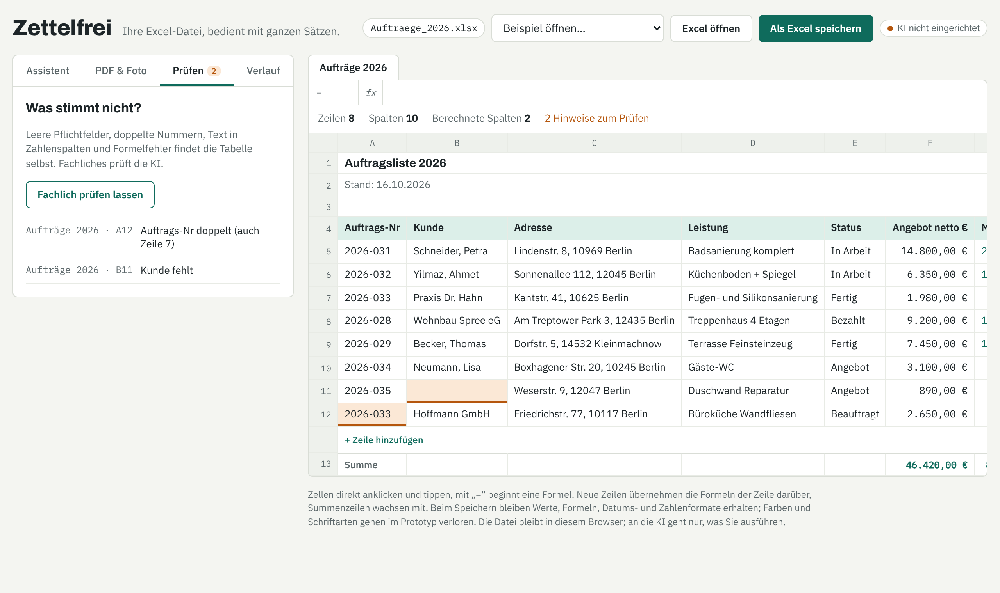

# Zettelfrei

**Excel bleibt. Das Tippen fällt weg.**

Zettelfrei öffnet die Excel-Dateien, die ein Handwerksbetrieb sowieso hat – Stundenzettel, Lagerliste, Auftragsliste – und lässt sie mit ganzen Sätzen bedienen:

- **Eintragen:** „Mehmet heute 7 Stunden Bad Schneider, Wand gefliest“ wird eine neue Zeile.
- **Ändern:** „Becker hat heute bezahlt“ setzt Status und Datum.
- **Fragen:** „Wie viele Stunden hatte Kevin im Oktober?“ – die Summe rechnet die Tabelle, nicht die KI.
- **PDF & Foto:** Lieferantenrechnung hineinziehen, der Lagerbestand wird erhöht. Auch gescannte PDFs.
- **Prüfen:** leere Pflichtfelder, doppelte Nummern, Text in Zahlenspalten, Formelfehler; fachliche Prüfung per KI.
- **Verlauf:** jeder Stand lässt sich zurückholen.
- **Speichern:** zurück als `.xlsx` mit Formeln, Datums- und Zahlenformaten.

Jede Änderung der KI wird vorher als „alt → neu“ angezeigt und erst nach Klick übernommen.



> Prototyp von **Bohdan Sychevskyi**. Feedback von Handwerksbetrieben ist sehr willkommen.

---

## Schnellstart

Voraussetzung: [Node.js](https://nodejs.org) ab Version 18. Keine weiteren Pakete nötig.

```bash
git clone https://github.com/<IHR-NAME>/zettelfrei.git
cd zettelfrei
npm start
```

Dann **http://localhost:8787** öffnen. Drei Beispieldateien sind eingebaut (oben „Beispiel öffnen…“), oder eine eigene Excel-Datei mit „Excel öffnen“ laden bzw. hineinziehen.

Ohne KI funktioniert bereits: Datei öffnen, Zellen bearbeiten, Formeln rechnen, Zeilen hinzufügen und löschen, Prüfen, Verlauf, Speichern.

## KI einrichten

Ein Klick auf den KI-Status oben rechts öffnet die Einstellungen. Drei Wege:

| Weg | Wofür | So geht's |
|---|---|---|
| **Eigener Server** (empfohlen) | Betrieb, mehrere Rechner | `ANTHROPIC_API_KEY=sk-ant-… npm start` – der Schlüssel bleibt auf dem Server, der Browser sieht ihn nie. |
| **Claude API im Browser** | eigener Rechner, schnell testen | Schlüssel aus [console.anthropic.com](https://console.anthropic.com) in den Einstellungen eintragen. Er wird nur im Browser gespeichert. |
| **Lokales Modell** | Daten verlassen den Rechner nicht | z. B. [Ollama](https://ollama.com): `OLLAMA_ORIGINS=* ollama serve`, Adresse `http://localhost:11434/v1`, Modell eintragen. Für Fotos/Scans ein Modell mit Bildverständnis nehmen. |

Weitere Server-Einstellungen:

```bash
ZF_MODEL=claude-sonnet-5-5   # Modell (Standard)
PORT=8787                    # Port
HOST=0.0.0.0                 # im Firmennetz erreichbar machen (Standard: nur dieser Rechner)
```

### Datenschutz

- Die Excel-Datei wird im Browser verarbeitet und nicht hochgeladen.
- An die KI geht nur, was Sie ausführen: der Tabelleninhalt als Text und ggf. das Dokument.
- Wer Kundendaten verarbeitet, sollte mit dem KI-Anbieter einen AV-Vertrag haben oder ein lokales Modell nutzen.

## Wie es funktioniert

```
Satz / PDF ──► KI ──► JSON-Plan: aenderungen + abfragen
                          │
     ┌────────────────────┴───────────────────┐
     ▼                                        ▼
Vorschau „alt → neu“                 Abfragen exakt gerechnet
     │ Klick „Übernehmen“            (Summe, Anzahl, Liste … mit Filtern)
     ▼
Excel-Engine: Zeile anlegen/ändern/löschen, Formeln mitziehen,
Summenbereiche erweitern, alles neu rechnen ──► Speichern als .xlsx
```

Die KI rechnet keine Summen selbst. Sie beschreibt nur, *was* gezählt oder summiert werden soll; die Tabelle rechnet das exakt aus. So entstehen keine erfundenen Zahlen.

Die Engine (`src/engine.js`) erkennt selbst:
- Titelzeilen über der Tabelle und die eigentliche Kopfzeile,
- Summenzeilen („Summe“, „Gesamt“, …) am Ende,
- Datums-, Zahlen- und berechnete Spalten,
- Formeln wie `=E4*F4`, `=SUMME(…)`, `=RUNDEN(…)`, `MIN`, `MAX`, `MITTELWERT`, `ANZAHL` sowie Bezüge auf andere Blätter.

## Projektaufbau

```
index.html            Oberfläche
src/engine.js         Excel-Engine: lesen, rechnen, ändern, schreiben (ohne Abhängigkeiten außer SheetJS)
src/ai.js             KI-Anbindung: eigener Server, Claude API, lokales Modell
src/app.js            Bedienung, Vorschau, Prüfen, Verlauf
src/styles.css        Gestaltung (hell und dunkel)
server.js             kleiner Server, leitet KI-Anfragen mit Schlüssel weiter
beispiele/            drei typische Excel-Dateien eines Fliesenlegers (erfundene Daten)
vendor/               SheetJS und PDF.js lokal, damit alles offline läuft
tests/                Tests für Engine, Server und Browser
```

## Tests

```bash
npm test                          # Engine + Server, ohne Abhängigkeiten
pip install playwright && python -m playwright install chromium
python tests/browser_test.py      # Ende-zu-Ende im Browser: ohne KI, Claude API, lokales Modell, Server
```

Die Browser-Tests bauen die KI-Antworten nach; ein echter Schlüssel ist nicht nötig.

## Grenzen des Prototyps

- Beim Speichern gehen Farben und Schriftarten verloren; Werte, Formeln und Zahlenformate bleiben.
- Formeln mit `WENN`, `SVERWEIS` u. Ä. werden nicht live neu berechnet, es wird der zuletzt gespeicherte Wert angezeigt.
- Beim Löschen von Zeilen werden Bezüge aus *anderen* Blättern nicht verschoben.
- Sehr große Dateien (viele tausend Zeilen) passen nicht vollständig in eine KI-Anfrage.

## Online ausprobieren (GitHub Pages)

Das Repository enthält einen Workflow, der die Seite auf GitHub Pages veröffentlicht (Einstellungen → Pages → Quelle „GitHub Actions“). Dort läuft alles außer dem eigenen Server; die KI wird mit eigenem Schlüssel oder lokalem Modell eingerichtet.

## English summary

Zettelfrei lets small trade businesses work with their existing Excel files in plain German sentences: add rows, update them, ask questions (totals are computed exactly by the sheet, not the model), import supplier invoices from PDF or photos, check for errors, and save back to `.xlsx` with formulas intact. AI is optional and pluggable: a tiny Node server holding the Anthropic key, the Claude API from the browser, or a local OpenAI-compatible model. Run with `npm start`.

## Lizenz

MIT © 2026 Bohdan Sychevskyi. Mitgelieferte Bibliotheken und Schriften stehen unter ihren eigenen Lizenzen (siehe `vendor/` und `fonts/`).
