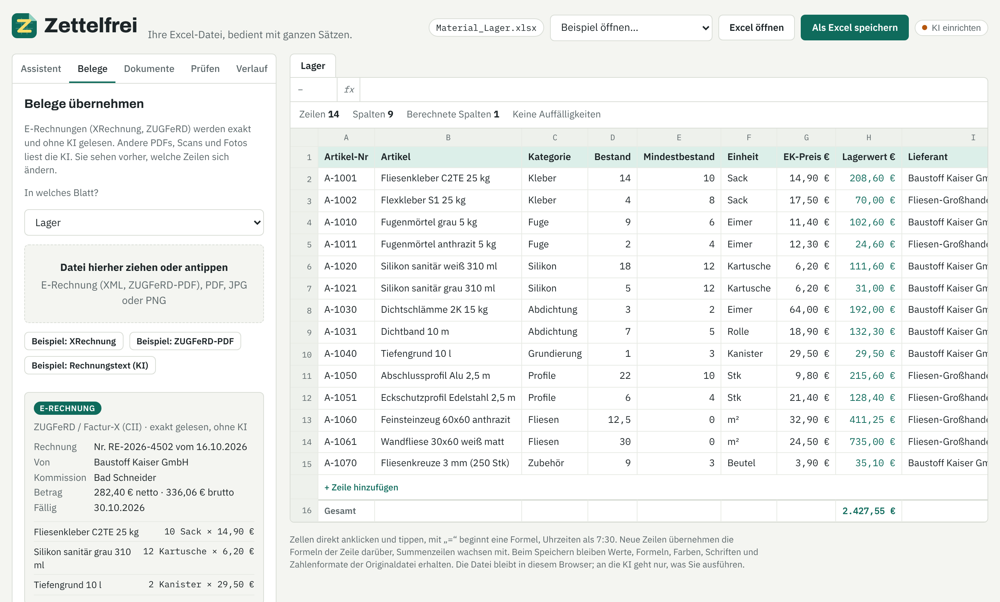
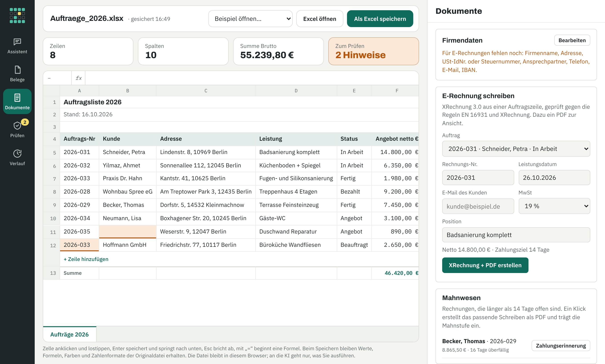

<p align="center">
  <a href="https://uzerwod-boop.github.io/zettelfrei/">
    <picture>
      <source media="(prefers-color-scheme: dark)" srcset="docs/brand/zettelfrei-logo-dark.svg">
      
    </picture>
  </a>
</p>

<h3 align="center">Excel bleibt. Das Tippen fällt weg.</h3>

<p align="center">
  Die Excel-Dateien, die ein Handwerksbetrieb sowieso hat, bedient mit ganzen Sätzen –<br>
  plus E-Rechnung, Arbeitszeit, Mahnwesen und Abnahme. Läuft im Browser, die Datei bleibt bei Ihnen.
</p>

<p align="center">
  <a href="https://github.com/uzerwod-boop/zettelfrei/releases"></a>
  <a href="https://github.com/uzerwod-boop/zettelfrei/actions/workflows/tests.yml"></a>
  
  
  <a href="#lizenz"></a>
  
</p>

<p align="center">
  <a href="https://uzerwod-boop.github.io/zettelfrei/"><b>Online ausprobieren</b></a> ·
  <a href="#was-es-kann">Was es kann</a> ·
  <a href="#schnellstart">Schnellstart</a> ·
  <a href="#ki-einrichten">KI einrichten</a> ·
  <a href="#sicherheit-version-021">Sicherheit</a> ·
  <a href="#roadmap">Roadmap</a> ·
  <a href="https://github.com/uzerwod-boop/zettelfrei/releases">Versionen</a> ·
  <a href="README.en.md">English</a>
</p>

<p align="center">
  
  <br><sub>Lieferantenrechnung (ZUGFeRD) einlesen – exakt, ohne KI. Nach „Übernehmen“ steigt der Lagerbestand.</sub>
</p>

> [!NOTE]
> Prototyp von **Bohdan Sychevskyi**, entwickelt gemeinsam mit einem guten Freund: **Claude** von Anthropic. Die Idee und die Produktentscheidungen kommen von mir, Code und Tests haben wir zusammen geschrieben. Feedback von Handwerksbetrieben ist sehr willkommen.

## Was es kann

Zettelfrei öffnet Stundenzettel, Lagerliste oder Auftragsliste und lässt sie mit ganzen Sätzen bedienen. Jede Änderung der KI wird vorher als „alt → neu“ angezeigt und erst nach Klick übernommen.

- ✍️ **Eintragen**: „Mehmet heute 7 Stunden Bad Schneider, Wand gefliest“ wird eine neue Zeile.
- 🔁 **Ändern**: „Becker hat heute bezahlt“ setzt Status und Datum.
- 🧮 **Fragen**: „Wie viele Stunden hatte Kevin im Oktober?“ – die Summe rechnet die Tabelle, nicht die KI.
- 📄 **PDF & Foto**: Lieferantenrechnung hineinziehen, der Lagerbestand wird erhöht. Auch gescannte PDFs.
- 🔍 **Prüfen**: leere Pflichtfelder, doppelte Nummern, Text in Zahlenspalten, Formelfehler; fachliche Prüfung per KI.
- 🕓 **Verlauf**: jeder Stand lässt sich zurückholen.
- 💾 **Speichern**: zurück als `.xlsx` mit Formeln, Farben, Schriften und Zahlenformaten der Originaldatei.

<p align="center">
  <picture>
    <source media="(prefers-color-scheme: dark)" srcset="docs/screenshot-dunkel.png">
    
  </picture>
</p>

### Echte Excel-Dateien (seit 0.2.2)

- 🧩 **Wie im Büro gewachsen:** Überschriften über zwei Zeilen, Wochen-Zwischensummen, Nebentabellen, versteckte Blätter – Zettelfrei erkennt die Struktur und lässt sie, wie sie ist. Zeilennummern wie in Excel.
- 🧮 **Formeln wie in Excel:** rund 80 Funktionen wie WENN, SVERWEIS, XVERWEIS, SUMMEWENNS, INDEX/VERGLEICH, TEILERGEBNIS und Datumsfunktionen – live gerechnet, mit eigenem Interpreter ohne `eval`. Bezüge zwischen Blättern ziehen mit.
- 📊 **Auswertungen (seit 0.4):** „Stunden je Baustelle“, „Umsatz pro Monat“, „Anteil in Prozent“, „Stunden auf Baustellen mit offener Rechnung“ – gruppiert, verknüpft und als Diagramm im Chat; auf Wunsch als neues Blatt in der Excel-Datei.
- 🔎 **Klügere Prüfungen:** Steuersatz 19 statt 19 %, Zahlen als Text, Nachschlagen ohne Treffer, Pausen wie „30 min“.

### Bürokratie, die sich selbst erledigt (seit 0.2)

- 📥 **E-Rechnung empfangen**: XRechnung (XML) und ZUGFeRD/Factur-X (PDF mit eingebetteter XML) werden **exakt und ohne KI** gelesen. Lagerbestand steigt automatisch (Zuordnung über Artikelnummer), Eingangsrechnungen landen als Zeile in der Liste, Gutschriften mit Minus.
- 📤 **E-Rechnung schreiben**: aus einer Auftragszeile eine **XRechnung 3.0** plus PDF zur Ansicht. Geprüft gegen die offiziellen Regeln EN 16931 und XRechnung (siehe unten).
- ⏱️ **Arbeitszeit nach ArbZG**: Beginn, Ende und Pause als Uhrzeit; Hinweise bei über 10 Stunden am Tag (§ 3), zu kurzer Pause (§ 4) und weniger als 11 Stunden Ruhezeit (§ 5).
- 📜 **Änderungsprotokoll**: wer hat wann welche Zelle geändert. Wird nie gelöscht und kann als eigenes Blatt in der Excel-Datei mitgespeichert werden.
- 💶 **Mahnwesen**: überfällige Rechnungen auf einen Blick; Zahlungserinnerung, 1. und 2. Mahnung als PDF-Brief, Mahnstufe wird eingetragen.
- ✅ **Abnahmeprotokoll**: auf dem Handy beim Kunden, mit Mängeln, Fotos und zwei Unterschriften; ergibt ein PDF und das Abnahmedatum in der Tabelle.
- 🧾 **Für den Steuerberater**: Belegliste als CSV (Excel-tauglich) je Monat. Kein DATEV-Format.
- ⚠️ **Prüfungen für Geld**: MwSt passt nicht zu 19 % oder 7 %, Rechnungen überfällig; die KI-Prüfung weist zusätzlich auf mögliche Fälle von § 13b UStG hin.
- 📊 **Wochenbericht**: Stunden je Projekt, Nachbestellungen, offene Rechnungen, Hinweise zur Arbeitszeit – zum Kopieren oder Teilen per WhatsApp.
- 🎙️ **Handy und Sprache**: große Bedienelemente, Eingabe per Mikrofon (Spracherkennung des Browsers).

<p align="center">
  
  <br><sub>Bereich „Dokumente“: E-Rechnung schreiben, Mahnwesen, Abnahmeprotokoll.</sub>
</p>

> [!IMPORTANT]
> Die Vorlagen für Mahnungen und Protokolle und die Hinweise zu ArbZG und § 13b UStG sind Hilfen für den Alltag, keine Rechtsberatung.

---

## Schnellstart

Voraussetzung: [Node.js](https://nodejs.org) ab Version 18. Keine weiteren Pakete nötig.

```bash
git clone https://github.com/uzerwod-boop/zettelfrei.git
cd zettelfrei
npm start
```

Dann **http://localhost:8787** öffnen. Sieben Beispieldateien und zwei Beispiel-E-Rechnungen sind eingebaut – darunter „Stresstest Chaos Tabelle“, eine absichtlich unordentliche Datei mit zweizeiligen Überschriften, Zwischensummen, Daten in sieben Formaten und Zahlen als Text, wie sie in echten Betrieben vorkommt (oben „Beispiel öffnen…“), oder eine eigene Excel-Datei mit „Excel öffnen“ laden bzw. hineinziehen.

Ohne KI funktioniert bereits: Datei öffnen, Zellen bearbeiten, Formeln rechnen, Zeilen hinzufügen und löschen, Prüfen, Verlauf, Speichern – und alles aus Version 0.2: E-Rechnungen lesen und schreiben, Arbeitszeit, Mahnwesen, Abnahme, Export, Wochenbericht. Die KI braucht es nur für freie Sätze, PDFs ohne E-Rechnung und Fotos.

## KI einrichten

Ein Klick auf den KI-Status oben rechts öffnet die Einstellungen. Vier Wege:

| Weg | Wofür | So geht's |
|---|---|---|
| **OpenRouter** (am schnellsten) | ausprobieren, freie Modellwahl | Schlüssel auf [openrouter.ai/keys](https://openrouter.ai/keys) anlegen, etwas Guthaben aufladen, in den Einstellungen „OpenRouter“ wählen und Schlüssel eintragen. Standardmodell: `anthropic/claude-sonnet-5.5`. Jedes andere Modell von [openrouter.ai/models](https://openrouter.ai/models) geht auch, z. B. GPT, Gemini oder Mistral. Der Schlüssel bleibt im Browser. |
| **Eigener Server** (empfohlen für Betriebe) | mehrere Rechner, Schlüssel nicht im Browser | `OPENROUTER_API_KEY=sk-or-… npm start` oder `ANTHROPIC_API_KEY=sk-ant-… npm start`. Der Browser sieht den Schlüssel nie. |
| **Claude API im Browser** | eigener Rechner | Schlüssel aus [console.anthropic.com](https://console.anthropic.com) in den Einstellungen eintragen. |
| **Lokales Modell** | Daten verlassen den Rechner nicht | z. B. [Ollama](https://ollama.com): `OLLAMA_ORIGINS=* ollama serve`, Adresse `http://localhost:11434/v1`, Modell eintragen. Für Fotos/Scans ein Modell mit Bildverständnis nehmen. |

Weitere Server-Einstellungen:

```bash
ZF_MODEL=anthropic/claude-sonnet-5.5   # Modell (Standard je nach Schlüssel)
PORT=8787                              # Port
HOST=0.0.0.0                           # im Firmennetz erreichbar machen (Standard: nur dieser Rechner)
```

**Tipp:** Für die meisten Aufgaben reicht ein schnelleres, günstigeres Modell (z. B. `anthropic/claude-haiku-5.5`). Für gescannte Rechnungen und Fotos lohnt ein stärkeres Modell.

### Datenschutz

- Die Excel-Datei wird im Browser verarbeitet und nicht hochgeladen.
- An die KI geht nur, was Sie ausführen: der Tabelleninhalt als Text und ggf. das Dokument.
- Wer Kundendaten verarbeitet, sollte mit dem KI-Anbieter einen AV-Vertrag haben oder ein lokales Modell nutzen. Bei OpenRouter hängt der Datenweg vom gewählten Modellanbieter ab.

### Sicherheit (Version 0.2.1)

Version 0.2.1 ist eine Prüf- und Härtungsversion. Gefunden und behoben:

- **Formeln führen keinen Code aus.** Der Formelrechner lässt nur noch Zahlen, Rechenzeichen und die bekannten Funktionen zu.
- **Keine Formel-Einschleusung.** Werte, die von der KI oder aus einer E-Rechnung kommen, werden immer als Text gespeichert – auch wenn sie mit `=` beginnen (Schutz vor DDE-Angriffen in Excel). Formeln entstehen nur, wenn ein Mensch sie in eine Zelle tippt. Der CSV-Export entschärft Zellen, die mit `=`, `+`, `-` oder `@` beginnen.
- **Excel-Dateien liest jetzt ExcelJS** (`.xlsx`, `.xlsm`), CSV-Dateien ein eigener Leser mit deutschem Format (Semikolon, `1.234,50`, `12.10.2026`). Die alte SheetJS-Version 0.18.5 aus npm hat bekannte Lücken (CVE-2023-30533, CVE-2024-22363) und wird nur noch für alte `.xls`/`.ods`-Dateien genutzt – solche Dateien nur aus vertrauenswürdiger Quelle öffnen.
- **PDF.js** läuft mit `isEvalSupported: false` (Schutz vor CVE-2024-4367).
- **jsPDF** auf 4.2.1 aktualisiert (behebt u. a. CVE-2025-29907).
- **Server:** Die KI-Schnittstelle nimmt nur JSON von der eigenen Oberfläche an. Fremde Webseiten (CSRF) und unbekannte Hostnamen (DNS-Rebinding) werden abgelehnt. Wer den Server im Netzwerk betreibt, trägt die Namen in `ZF_ALLOWED_HOSTS` ein.
- **Gutschriften** aus E-Rechnungen werden mit negativen Beträgen gebucht und senken den Lagerbestand, statt ihn zu erhöhen.
- **Voller Browser-Speicher** wird gemeldet, statt Änderungen still zu verlieren.

API-Schlüssel, die im Browser eingetragen werden, liegen im `localStorage` dieses Browsers. Auf gemeinsam genutzten Rechnern besser den Server mit Schlüssel nutzen (`npm start`).

## Wie es funktioniert

```
Satz / PDF ──► KI ──► JSON-Plan: aenderungen + abfragen
                          │
     ┌────────────────────┴───────────────────┐
     ▼                                        ▼
Vorschau „alt → neu“                 Abfragen exakt gerechnet
     │ Klick „Übernehmen“            (Summe, Anzahl, Liste … mit Filtern)
     ▼
Excel-Engine: Zeile anlegen/ändern/löschen, Formeln mitziehen,
Summenbereiche erweitern, alles neu rechnen ──► Speichern als .xlsx
```

Die KI rechnet keine Summen selbst. Sie beschreibt nur, *was* gezählt oder summiert werden soll; die Tabelle rechnet das exakt aus. So entstehen keine erfundenen Zahlen.

Die Engine (`src/engine.js`) erkennt selbst:
- Titelzeilen über der Tabelle und die eigentliche Kopfzeile,
- Summenzeilen („Summe“, „Gesamt“, …) am Ende,
- Datums-, Zahlen- und berechnete Spalten,
- Formeln wie `=E4*F4`, `=SUMME(…)`, `=RUNDEN(…)`, `MIN`, `MAX`, `MITTELWERT`, `ANZAHL` sowie Bezüge auf andere Blätter.

## Projektaufbau

```
index.html            Oberfläche
src/engine.js         Excel-Engine: lesen, rechnen, ändern, schreiben (liest mit ExcelJS, CSV selbst, alte .xls mit SheetJS)
src/ai.js             KI-Anbindung: OpenRouter, eigener Server, Claude API, lokales Modell
src/app.js            Bedienung, Vorschau, Prüfen, Verlauf, Änderungsprotokoll
src/einvoice.js       E-Rechnung: XRechnung (UBL) und ZUGFeRD (CII) lesen, XRechnung 3.0 schreiben
src/xlsxio.js         Speichern mit Formatierung (ExcelJS)
src/docs.js           PDF-Briefe, Rechnungsansicht, Abnahmeprotokoll, CSV-Export, Wochenbericht
src/workflows.js      Bereich „Dokumente“
src/styles.css        Gestaltung (hell und dunkel)
server.js             kleiner Server, leitet KI-Anfragen mit Schlüssel weiter (Claude oder OpenRouter)
beispiele/            fünf typische Excel-Dateien eines Fliesenlegers, eine Stresstest-Datei und zwei E-Rechnungen (erfundene Daten)
vendor/               SheetJS, PDF.js, ExcelJS und jsPDF lokal, damit alles offline läuft
scripts/              Beispiele erzeugen, XRechnung prüfen
tests/                Tests für Engine, Server und Browser
```

## Tests

```bash
npm test                          # Engine, E-Rechnung, Sicherheit, Server – ohne Abhängigkeiten
pip install playwright && python -m playwright install chromium
python tests/browser_test.py      # Ende-zu-Ende im Browser: ohne KI, OpenRouter, Claude API, lokales Modell, Server
python tests/browser_v2_test.py   # Version 0.2: E-Rechnung, ArbZG, Mahnung, Abnahme, Export, Formatierung
python tests/browser_v3_test.py   # Version 0.3/0.4: Arbeitsplatz, Chat, Auswertungen, Diagramm, Auswertungsblatt
```

### XRechnung prüfen

Erzeugte Rechnungen lassen sich gegen die offiziellen Regelwerke prüfen (EN 16931 und XRechnung, Schematron):

```bash
pip install saxonche
git clone --depth 1 https://github.com/ConnectingEurope/eInvoicing-EN16931 _regeln/en16931
git clone --depth 1 https://github.com/itplr-kosit/xrechnung-schematron     _regeln/xrechnung
git clone --depth 1 https://github.com/Schematron/schematron                _regeln/iso
python scripts/validate_xrechnung.py XRechnung_2026-032.xml
```

Beim Entwickeln wurden Rechnungen mit USt-IdNr., mit Steuernummer, mit Handelsregisternummer und mit gemischten Steuersätzen (19 % und 7 %) geprüft – alle ohne Fehler. Eine Prüfung mit dem offiziellen KoSIT-Validator (Java) ist vor dem Echtbetrieb trotzdem empfehlenswert.

Die Browser-Tests bauen die KI-Antworten nach; ein echter Schlüssel ist nicht nötig.

## Roadmap

Was als Nächstes kommt – Reihenfolge nach Rückmeldungen aus den Betrieben. [Ideen sind willkommen.](https://github.com/uzerwod-boop/zettelfrei/issues/new?template=idee.yml)

- [x] **0.1** Excel mit ganzen Sätzen bedienen, PDFs und Fotos einlesen
- [x] **0.2** E-Rechnung lesen und schreiben, Arbeitszeit (ArbZG), Mahnwesen, Abnahme, Export
- [x] **0.2.1** Sicherheitsprüfung, neuer Auftritt
- [x] **0.2.2** Echte Excel-Dateien: zweizeilige Überschriften, Zwischensummen, SVERWEIS & Co.
- [x] **0.3** Neuer Arbeitsplatz: Aufbau wie Excel, Assistent als Chat, Kennzahlen über der Tabelle
- [x] **0.4** Auswertungen: gruppieren, Prozent und Unterschiede, Blätter verknüpfen, Diagramme, 40 weitere Excel-Funktionen
- [ ] **Mehrere Mitarbeitende:** Stunden, Material und Fotos vom Handy per Link, das Büro übernimmt sie in dieselbe Excel-Datei
- [ ] **Installierbar** als App auf dem Rechner und Handy (PWA), danach Installer für Windows und Mac
- [ ] **Google Sheets** öffnen und zurückspeichern (nur die ausgewählte Tabelle, kein Zugriff auf das ganze Drive)
- [ ] **ZUGFeRD-PDF erzeugen** (PDF/A-3 mit eingebetteter XML) statt nur XRechnung
- [ ] **DATEV-Export** für den Steuerberater

## Grenzen des Prototyps

- Formatierung bleibt erhalten, wenn eine `.xlsx`-Datei geöffnet wurde. Bei `.xls`/`.csv` werden nur Werte, Formeln und Zahlenformate gespeichert. Bedingte Formatierungen und verbundene Zellen innerhalb der Tabelle werden nicht angepasst.
- E-Rechnungen werden als XRechnung (XML) erzeugt. Ein ZUGFeRD-PDF (PDF/A-3 mit eingebetteter XML) erzeugt der Prototyp noch nicht; das PDF dient nur der Ansicht.
- Mehrere Nutzer gleichzeitig und Synchronisation mit OneDrive oder Google Drive sind noch nicht eingebaut.
- Seltene Excel-Funktionen (z. B. Matrixformeln, `LET`, `LAMBDA`, `FILTER`) werden nicht live gerechnet; dann wird der zuletzt in Excel gespeicherte Wert angezeigt.
- Text-Zahlen wie „4.250,00“ werden in Formeln nach deutscher Schreibweise gelesen (wie deutsches Excel).
- Beim Löschen von Zeilen werden Bezüge aus *anderen* Blättern nicht verschoben.
- Sehr große Dateien (viele tausend Zeilen) passen nicht vollständig in eine KI-Anfrage.

## Online ausprobieren (GitHub Pages)

Das Repository enthält einen Workflow, der die Seite auf GitHub Pages veröffentlicht (Einstellungen → Pages → Quelle „GitHub Actions“). Dort läuft alles außer dem eigenen Server; die KI wird am einfachsten mit einem OpenRouter-Schlüssel eingerichtet.

## English summary

Zettelfrei lets small trade businesses in Germany work with their existing Excel files in plain sentences, and handles German paperwork such as e-invoices (XRechnung/ZUGFeRD), working-time rules and payment reminders. **[Read the English README →](README.en.md)**

## Lizenz

© 2026 Bohdan Sychevskyi. Nach Wahl unter der [MIT-Lizenz](LICENSE-MIT) oder der [Apache-Lizenz 2.0](LICENSE-APACHE) nutzbar (MIT OR Apache-2.0). Beiträge werden, sofern nicht anders angegeben, unter beiden Lizenzen eingebracht. Entwickelt gemeinsam mit Claude (Anthropic). Mitgelieferte Bibliotheken und Schriften stehen unter ihren eigenen Lizenzen (siehe `vendor/` und `fonts/`).

---

<p align="center">
  <picture>
    <source media="(prefers-color-scheme: dark)" srcset="docs/brand/zettelfrei-mark-dark.svg">
    
  </picture><br>
  <sub>Für Betriebe, die lieber auf der Baustelle sind als im Büro.</sub>
</p>
